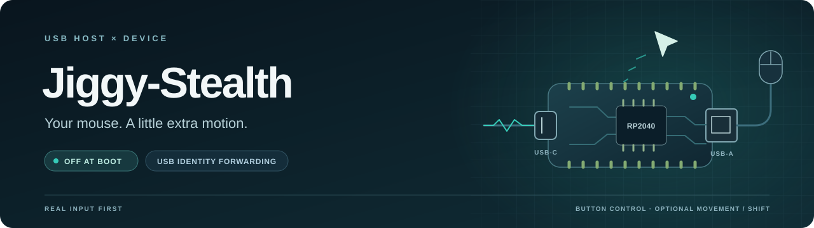

<p align="center">
  
</p>

<h1 align="center">Jiggy-Stealth</h1>

<p align="center">Your mouse, passed through. A little extra motion when you choose.</p>

<p align="center">
  <a href="docs/USER_GUIDE.md"></a>
  <a href="firmware/JiggyStealth/Config.h"></a>
  <a href="docs/VERIFICATION.md"></a>
  
  <a href="LICENSE"></a>
</p>

Jiggy-Stealth turns an [Adafruit Feather RP2040 USB Host](https://www.adafruit.com/product/5723) into a USB mouse bridge with optional idle movement or brief Shift presses. It forwards the attached device's USB identity and gives real mouse input priority. Tested with a Logitech M305 and its USB receiver.

**Movement is the default mode. Jiggle starts OFF after every restart.**

**[Download the latest release](https://github.com/neusse/Jiggy-Stealth/releases/latest)** — two ready-to-flash builds, complete source/build ZIP, quick flashing guide, and SHA-256 checksums. Installing a UF2 needs no compiler or development tools.

| Build | Download | USB interfaces |
| --- | --- | --- |
| **Production** — everyday use | [Jiggy-Stealth.uf2](https://github.com/neusse/Jiggy-Stealth/releases/latest/download/Jiggy-Stealth.uf2) | Mouse + keyboard HID; **no serial/COM port**, including at startup |
| **Diagnostics** — troubleshooting | [Jiggy-Stealth-Diagnostics.uf2](https://github.com/neusse/Jiggy-Stealth/releases/latest/download/Jiggy-Stealth-Diagnostics.uf2) | The same full bridge plus USB serial for status and packet capture |

Both builds have the same mouse forwarding, identity forwarding, and Movement/Shift features. **UF2 updates need no serial connection:** hold Boot, press/release Reset, and copy either UF2 to `RPI-RP2`. Flash one build at a time; see [flashing and recovery](docs/USER_GUIDE.md#flashing-and-recovery).

## Get started

1. Connect the Feather's USB-C port to your computer and plug your paired mouse receiver into its USB-A port.
2. Download [Jiggy-Stealth.uf2](https://github.com/neusse/Jiggy-Stealth/releases/latest/download/Jiggy-Stealth.uf2) and follow the [flashing guide](docs/USER_GUIDE.md#flashing-and-recovery).
3. Short-press **Boot** to enable or disable jiggle. Green means Movement is enabled; dim blue means off.

After 30–60 seconds without mouse activity, Movement adds a tiny excursion and return. Hold Boot for two seconds to select Movement or Shift; the selected mode stays off until a short press. Pair wireless receivers directly on the computer before using the bridge.

USB identity forwarding copies IDs and name strings. The bridge exposes its own mouse/keyboard HID layout, with serial added only by Diagnostics; see [USB identity and compatibility](docs/USER_GUIDE.md#usb-identity-and-receiver-support) for the supported behavior.

## Optional 3D-printed case

Adafruit's [Case for Feather RP2040 USB Host](https://learn.adafruit.com/case-for-feather-rp2040-usb-host), designed by the Ruiz Brothers, fits the same board used by Jiggy-Stealth. It snaps together without screws, leaves both USB ports accessible, and includes actuators for **Boot** and **Reset**, so you can toggle jiggle without opening the case. The [CAD files page](https://learn.adafruit.com/case-for-feather-rp2040-usb-host/cad-files) provides printable STLs and editable STEP/Fusion 360 files; the guide also covers assembly.

## Documentation

Start with the **[documentation index](docs/README.md)** for controls, LEDs, setup, USB identity, diagnostics, configuration, and verification.

- [User guide](docs/USER_GUIDE.md) — use, build, flash, and troubleshoot.
- [Verification](docs/VERIFICATION.md) — automated coverage and observed hardware results.
- [Implementation plan](IMPLEMENTATION_PLAN.md) · [Firmware research](docs/FIRMWARE_RESEARCH.md).

To build on Windows with PowerShell 7 and Arduino CLI or Arduino IDE 2 installed:

```powershell
pwsh -File .\scripts\setup.ps1
pwsh -File .\scripts\test.ps1
pwsh -File .\scripts\build.ps1
```

## License

Personal and noncommercial use, modification, and sharing are permitted under the [PolyForm Noncommercial License 1.0.0](LICENSE). Commercial use, including commercial derivatives, requires a separate written commercial license from the repository owner, subject to the full license's permissions. See [licensing details](LICENSING.md) and [NOTICE](NOTICE).

Dependency sources and their independent licenses are listed in [third-party notices](THIRD_PARTY_NOTICES.md).
